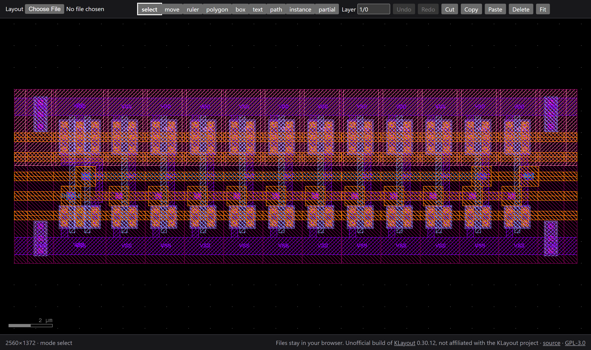

# klayout-wasm

[KLayout](https://www.klayout.de)'s layout view and editing tools compiled to
WebAssembly, with a typed JavaScript API, for building layout viewers and
editors that run in a browser or a VS Code webview.

**Try it: <https://matanco64.github.io/klayout-wasm/>**, the demo page below,
built from `master`.

This is an **unofficial** build. It is not affiliated with or endorsed by the
KLayout project. KLayout's own source is used unmodified as a git submodule;
the two edits Emscripten needs are applied to copies at build time.



*The demo page (`web/`): KLayout's `ringo.gds` sample rendered and editable in
the browser. Open your own GDS or OASIS file with **Layout**; it never leaves
the browser.*

## Status

| Phase | Scope | State |
|---|---|---|
| 0 | `tl`, `gsi`, `db`, GDS2 + OASIS readers/writers | **done** |
| 1 | `laybasic` + `layview` + `edt` + `ant`: render, mouse input, all edit modes | **done** |
| 2 | API: shapes, cells, instances, edits as undo steps, edit commands, selection, export, layer panel, change notifications | **done**: headless (Bun, Node) and in Chrome |
| 3 | npm package with a Web Worker, VS Code webview example, CI, release | planned |

`test/klayout.test.mjs` checks all of it headless, with assertions. Some of
what it prints:

```
inspect: ringo.gds and drcFullTest_1.oas match native KLayout; garbage rejected
bad input is rejected with the field named
box drawn by KLayout's tool: [{"left":7831,"bottom":3513,"right":12064,"top":7746,"kind":"box"}]
frame: 1246 pixels changed by the new box
all 7 shape kinds round-trip exactly
a failing edit applies nothing and leaves no undo step
copy + paste, select all + delete, undo: ok (152 shapes)
.lyp: 6191 bytes, round-trips visibility
```

In Chrome (`web/`): the layout renders with KLayout's stipples and labels;
every mode works from the mouse, with KLayout's rubber bands; wheel zoom;
select, Delete, Cmd+Z, Cmd+C, Cmd+V (the paste follows the mouse until a
click).

## Using it

```js
import createKlayout from "./klayout.js";

const k = await createKlayout();
const view = new k.View(true);                     // editable
view.resize(800, 600);
view.open(gdsBytes);                               // GDS2 or OASIS, detected
view.mouse("press", x, y, { left: true });         // KLayout's tools do the rest
const { width, height, rgba } = view.frame();      // paint into a canvas

view.edit("add pin", [                             // one undo step, all or nothing
  { op: "insertShape", cell: "TOP", layer: { layer: 1, datatype: 0 },
    shape: { kind: "box", left: 0, bottom: 0, right: 100, top: 100 } },
]);
for (const change of view.changes()) { /* layoutChanged, selectionChanged, ... */ }
const oasis = view.export("oasis");
view.delete();                                     // Embind objects are freed explicitly
```

The build emits `klayout.d.ts`, generated from `src/bindings.cc`, with every
method and value type. Coordinates are integer database units (`view.dbu()`
micrometers each).

| Area | Methods |
|---|---|
| Files | `open(bytes)`, `export("gds2" \| "oasis")`, `inspect(bytes)` (module function) |
| Input and rendering | `resize`, `setDevicePixelRatio` (HiDPI frames, CSS-pixel input), `mouse`, `wheel`, `key`, `frame`, `modes`, `mode`, `switchMode`, `setCurrentLayer` |
| Viewport and cells | `zoomFit`, `zoomBox(rect)`, `viewport()`, `pointAt(x, y)` (layout point under a CSS pixel), `showCell(name)`, `currentCell()` |
| Settings | `configure({ grid, editGrid, snapToObjects, gridVisible, background, connectAngle })`, through KLayout's own configuration keys |
| Reading | `dbu`, `cells`, `layers`, `shapes(cell, layer)`, `instances(cell)`, `selection` |
| Writing | `edit(description, edits)`: insert/erase shapes and instances, create/delete/rename cells |
| Edit menu | `command(...)`: delete, cut, copy, paste, pasteMove, selectAll, unselectAll, cancel |
| History | `undo`, `redo`, `history` (KLayout's undo/redo labels) |
| Layer panel | `layerPanel`, `setLayerVisible`, `loadLayerProperties`, `saveLayerProperties` (.lyp) |
| Markers | `setMarkers([{ shape, color, frameColor, lineWidth, vertexSize, ditherPattern, halo }])`: overlays in database units, e.g. check results; not shapes and not undo steps; a bad entry replaces nothing. `clearMarkers`, `markerCount`; `open` drops them |
| Changes | `changes()`: what changed since the last call, whoever changed it, including KLayout's own tools reacting to input |

Values are checked as they are read: a missing or mistyped field throws a
JavaScript `Error` that names it. Shapes and instances are identified by
value (`eraseShape` removes one equal shape). KLayout normalizes polygons
(hull clockwise, holes counterclockwise), so a polygon reads back in that
form.

## Layout

```
CMakeLists.txt             the build
tools/klayout_sources.py   reads KLayout's .pro files; applies the two patches
src/                       view.cc (View), convert.cc (JS <-> KLayout values),
                           bindings.cc (Embind and the TypeScript types)
test/                      klayout.test.mjs: the whole API, headless
web/                       minimal demo page: canvas, input forwarding, mode buttons
vendor/klayout/            KLayout v0.30.12 (submodule, unmodified)
vendor/libexpat/           Expat R_2_9_0 (submodule): KLayout's XML parser without Qt
```

## Building

Requirements: Emscripten 6.0.12 (`emsdk`), CMake 3.24+, Ninja, Python 3
(emsdk needs it anyway), and Bun or Node 22+ for the tests.

```sh
git submodule update --init --depth 1
source ~/emsdk/emsdk_env.sh
emcmake cmake -B build -G Ninja
cmake --build build                  # build/klayout.{js,wasm,d.ts}
bun test/klayout.test.mjs            # or: node test/klayout.test.mjs
```

The demo:

```sh
cp build/klayout.{js,wasm} web/ && cp vendor/klayout/samples/lvs/ringo.gds web/
python3 -m http.server -d web 8765   # then open http://127.0.0.1:8765
```

A clean build compiles 440 KLayout translation units and takes about two
and a half minutes on a 16-core machine. CMake writes
`build/compile_commands.json`; `.clangd` points editors at it.

## Deploying the demo

`.github/workflows/pages.yml` builds the module from each push to `master`,
runs the tests and publishes the page to GitHub Pages. To host it elsewhere:

`tools/make_site.sh` assembles `site/`: the page, the module, a sample
layout, the license, and precompressed `.br`/`.gz` copies. Copy it to any
static file server. No special headers are needed (no SharedArrayBuffer, no
cross-origin isolation, no `eval`), but serve the precompressed files rather
than compressing 28 MB per request. Caddy, under a path prefix:

```caddy
redir /klayout-wasm /klayout-wasm/
handle_path /klayout-wasm/* {
	root * /var/www/klayout-wasm
	file_server {
		precompressed br gzip
	}
}
```

The page links to this repository and its license. Keep that link working
wherever it is hosted: the module is a combined work with KLayout, and the
GPL requires the corresponding source to be available to anyone the binary
is served to.

## How the build works

- **Source lists come from KLayout's own `.pro` files.**
  `tools/klayout_sources.py` evaluates them under a Qt-free configuration
  (`HAVE_QT=0`, no curl, git2, threads or scripting), so a KLayout upgrade is
  a submodule bump. It fails on any qmake construct it does not know, rather
  than silently dropping sources.
- **Patches are exact and counted.** Each edit must match exactly once or
  the build fails. There are two, both platform branches KLayout lacks for
  Emscripten (`tlTimer.cc` memory size, `tlThreads.cc` timed join), and both
  are candidates for upstreaming.
- **Object libraries, linked directly.** KLayout registers its stream
  formats from static objects nothing references by name; linking object
  files rather than archives keeps them.
- **Exceptions are native WebAssembly exceptions** (legacy encoding, which
  every current browser runs). Every API function catches C++ exceptions
  and rethrows them as JavaScript `Error`s.
- **The view runs in synchronous mode**, so there is no redraw thread and no
  need for SharedArrayBuffer or cross-origin isolation.

## Known gaps

- `klayout.wasm` is 28 MB uncompressed, 6.4 MB gzipped. Nothing has been
  done about size yet: `-Oz`, `wasm-opt`, and dropping the scripting
  declarations (`gsiDecl*`) are the obvious first steps.
- The demo runs KLayout on the main thread. The module is pure compute and
  runs unchanged in a Web Worker, which is how silicon-studio hosts it.
- Not carried through the API yet: user properties on shapes and instances
  (GDS properties), KLayout's PCells and libraries, and view-only markers.
- KLayout's editor cannot select edges and edge pairs (DRC result types), so
  `selectAll` + `delete` leaves them, as on desktop.
- `layoutChanged` comes from KLayout's undo journal, so a change made
  outside an undo step would go unnoticed. Every path through this API and
  KLayout's tools uses one.
- Expat's entropy comes from `getentropy`; untested under every embedding.

## License

GPL-3.0-or-later, as required by KLayout (GPL-2.0-or-later source files,
GPL-3.0 as distributed). Anything that embeds the WebAssembly module is a
combined work under the GPL. Expat is MIT.
